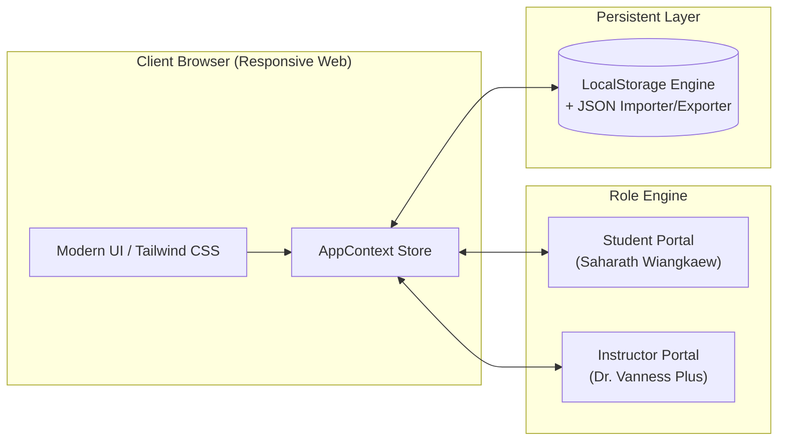

# 🎓 EduTrack: Student Performance & Evaluation Tracking System

> **Skill Test for Fullstack Developer Trainee**  
> **Applicant**: Saharath Wiangkaew (นายสหรัฐ เวียงแก้ว)  
> **Company**: Vanness Plus Consulting Co., Ltd.

---

## 📌 Executive Summary & Project Overview

**EduTrack** เป็นระบบเว็บแอปพลิเคชัน Fullstack ที่พัฒนาขึ้นตามโจทย์ **Option 4: Student Performance Tracking System** เพื่อเป็นเครื่องมือสำหรับนักศึกษาและอาจารย์ในการติดตามและประเมินผลการเรียนรู้ การส่งงาน ตลอดจนการสอบต่างๆ อย่างเป็นรูปธรรม

ระบบถูกออกแบบให้รองรับ **Dual-Role Interaction** อย่างสมบูรณ์ โดยมีจุดเด่นคือ:
1. **Student Profile & Status Tracking**: แสดงข้อมูลนักศึกษา (ชั้นปีที่ 3 วิศวกรรมคอมพิวเตอร์), งานมอบหมาย, วันกำหนดส่ง (Due Date), สถานะการส่งงาน (`ยังไม่ส่ง`, `รอตรวจ`, `ส่งล่าช้า`, `ตรวจแล้ว`)
2. **Bilateral Evaluation Notes (โน้ต 2 ฝั่ง)**:
   - 👨‍🎓 **โน้ตฝั่งนักศึกษา (Student Reflection Note)**: สำหรับบันทึกแนวคิด ปัญหาที่พบ หรือข้อคำถาม
   - 👨‍🏫 **โน้ตฝั่งอาจารย์ (Instructor Feedback Note)**: ข้อเสนอแนะ จุดเด่น และสิ่งที่ควรพัฒนาต่อยอด
3. **Automated Grade Projection**: คำนวณตัดเกรดอิงเกณฑ์มาตรฐาน (A, B+, B, C+, C, D+, D, F) และ GPA คาดการณ์อัตโนมัติ
4. **Performance & Punctuality Analytics**: วิเคราะห์อัตราการส่งงานตรงเวลา (On-time Rate) และสัดส่วนคะแนนสะสมแยกตามหมวดหมู่
5. **Instant Evaluator Role Switcher**: ปุ่มสลับโหมด Student ⇄ Instructor ในคลิกเดียว พร้อมปุ่ม "Reset Demo Data" ช่วยให้กรรมการผู้ประเมินสามารถทดสอบระบบได้อย่างสะดวก รวดเร็ว และลื่นไหลที่สุด

---

## 🛠️ Tech Stack & Architecture

- **Frontend & UI**:
  - **React 18** + **TypeScript** (Strongly Typed Contracts)
  - **Vite** (Next-generation lightning fast build tool)
  - **Tailwind CSS** (Modern utility-first styling)
  - **Lucide React** (Clean, consistent modern icons)
- **State & Data Persistence**:
  - **React Context API** (Reactive Global Store across roles)
  - **Structured LocalStorage Engine** with Auto-sync & JSON Export
- **Deployment Platform**:
  - **Vercel** / Static Cloud Edge Hosting



---

## 🚀 Key Features

| หมวดหมู่ | ฟีเจอร์หลัก | รายละเอียด |
|---|---|---|
| **1. Student Information** | • ข้อมูลนักศึกษาครบถ้วน | แสดงชื่อ-สกุล, รหัสนักศึกษา, ระดับชั้นปี (Year 3), สาขาวิชา, คณะ และวิชาที่ลงทะเบียน |
| **2. Assignment Management** | • รายการงานและการสอบ | แยกประเภทงานชัดเจน: การบ้าน (Assignment), แบบทดสอบย่อย (Quiz), การสอบ (Exam), โครงงาน (Project) |
| | • กำหนดเวลา (Due Dates) | แสดงวันที่และเวลากำหนดส่ง พร้อมระบบตรวจจับส่งล่าช้า (Late Submission) |
| **3. Submission Flow** | • แนบผลงาน | รองรับการแนบลิงก์ (GitHub, Demo, Google Drive) หรือส่งข้อความรายงาน |
| | • **โน้ตฝั่งนักศึกษา** | ช่องกรอก Reflection Note บันทึกแนวทางการแก้ปัญหาและสิ่งที่ได้เรียนรู้ |
| **4. Instructor Evaluation** | • ศูนย์ตรวจงาน | ตรวจสอบงานที่ส่ง ตรวจสอบเวลาส่งเทียบ Due Date |
| | • การให้คะแนน | กรอกคะแนนพร้อม Validation ป้องกันคะแนนเกิน Max Score |
| | • **โน้ตฝั่งอาจารย์** | ให้ Feedback และข้อเสนอแนะแก่นักศึกษาเพื่อการพัฒนา |
| **5. Grade & Report** | • ตัดเกรดอัตโนมัติ | คำนวณเกรด A, B+, B, C+, C, D+, D, F และ GPA อัตโนมัติ |
| | • ใบบันทึกผลการเรียน | ตารางสรุปคะแนนพร้อมโน้ต 2 ฝั่ง รองรับการพิมพ์/เซฟ PDF (Print-ready) |
| **6. Experience & Testing** | • 1-Click Role Switcher | สลับบทบาทระหว่างนักศึกษาและอาจารย์ได้ทันทีโดยไม่ต้อง Sign In ซ้ำ |
| | • Reset Demo Data | กู้คืนข้อมูลตัวอย่างมาตรฐานของนายสหรัฐ เวียงแก้ว ได้ตลอดเวลา |

---

## 💻 How to Run Locally

### Requirements
- Node.js version 18.x or 20.x+
- npm version 9.x+

### Steps
1. โคลนหรือเปิดโฟลเดอร์โปรเจกต์:
   ```bash
   cd d:\vanness-test
   ```
2. ติดตั้ง Dependencies:
   ```bash
   npm install
   ```
3. รัน Development Server:
   ```bash
   npm run dev
   ```
   เปิดเบราว์เซอร์ไปที่ `http://localhost:5173`

4. ทดสอบ Build สำหรับ Production:
   ```bash
   npm run build
   ```

---

## 📋 คู่มือการทดสอบสำหรับผู้ประเมิน (Evaluator Quick Walkthrough)

1. **เปิดเว็บแอปพลิเคชัน**: ระบบจะเริ่มต้นที่ **"มุมมองนักศึกษา (Student View)"** ของนายสหรัฐ เวียงแก้ว
2. **ทดลองส่งงาน**:
   - คลิกที่งาน *"Final Project: Enterprise Student Performance Tracking Platform"* ที่ยังไม่ได้ส่ง
   - กรอกลิงก์ผลงาน GitHub และกรอก **"โน้ตจากนักศึกษา"** แล้วกดยืนยันการส่งงาน
   - สังเกตสถานะจะเปลี่ยนเป็น **"รอตรวจ (Submitted)"**
3. **สลับไปมุมมองอาจารย์**:
   - คลิกปุ่ม **"มุมมองอาจารย์ (Instructor)"** บนแถบด้านบน
   - สังเกตป้ายแจ้งเตือนงานที่รอตรวจ
   - ไปที่แท็บ **"ศูนย์ตรวจงานและให้คะแนน (Grading Center)"** แล้วคลิก **"ตรวจงาน & ให้คะแนน"**
   - อ่านผลงานและอ่าน **"โน้ตจากนักศึกษา"**
   - กรอกคะแนน และพิมพ์ **"โน้ต/Feedback จากอาจารย์"** แล้วกดบันทึก
4. **ดูผลการตัดเกรด**:
   - คลิกแท็บ **"ใบบันทึกผลและตัดเกรด (Grade Evaluation Report)"** เพื่อดูการคำนวณเกรดและตารางโน้ตทั้ง 2 ฝั่งคู่กัน
   - สลับกลับไปมุมมองนักศึกษา จะพบว่าคะแนนและเกรดได้รับการอัปเดตเรียบร้อย

---

## 📦 โครงสร้างไฟล์สำหรับส่งมอบ (Submission Package Structure)

```
Skill Test for Fullstack Developer Trainee_Saharath Wiangkaew/
├── Video/                           # คลิปนำเสนอเดโมระบบ (3-5 นาที)
├── Presentation/                    # สไลด์นำเสนอโครงสร้างและฟีเจอร์ระบบ (PDF/PPTX)
├── Copied of ID Card/               # สำเนาบัตรประชาชน
├── Transcript/                      # ใบแสดงผลการศึกษา
├── Source Code & Deployment Link    # ลิงก์ GitHub Repo และลิงก์ Vercel Deployed Web App
```

---
*จัดทำด้วยความมุ่งมั่นโดย นายสหรัฐ เวียงแก้ว (Saharath Wiangkaew) สำหรับการคัดเลือกตำแหน่ง Fullstack Developer Trainee ที่ บริษัท แวนเนส พลัส คอนซัลติ้ง จำกัด (Vanness Plus Consulting Co., Ltd.)*
